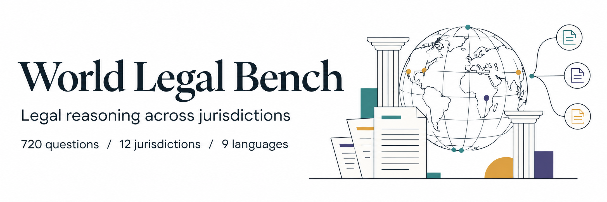
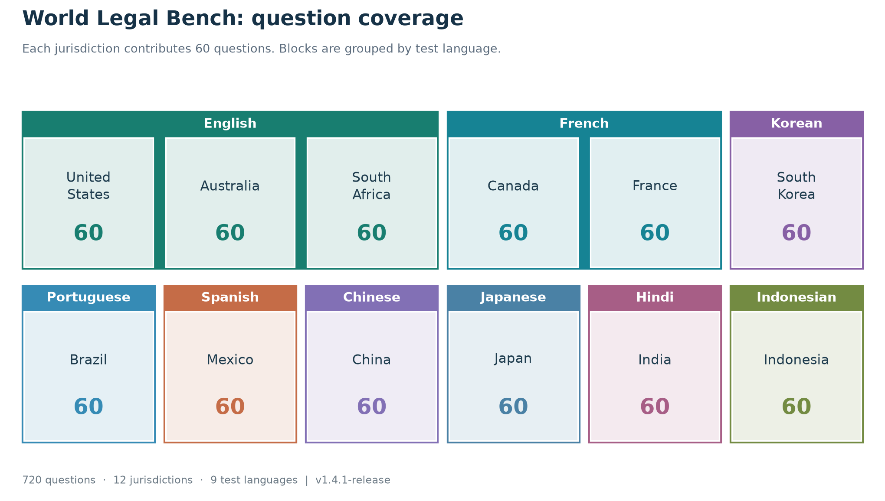
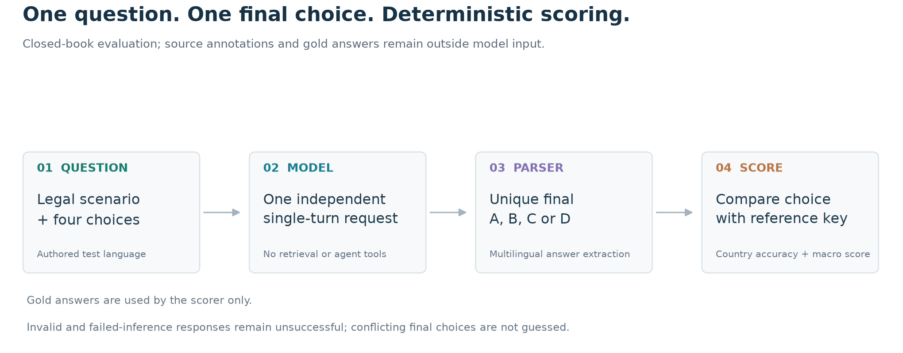

<p align="center"></p>

# World Legal Bench

### Native-language legal reasoning across twelve jurisdictions

**World Legal Bench evaluates whether a language model can apply the legal rules of a particular jurisdiction, in that jurisdiction's selected test language.** Its questions require models to distinguish institutional powers, combine provisions, resolve procedural conditions, and identify the legal consequences of a changed fact.

The **v1.4.1-release** contains **720 source-linked multiple-choice questions**, with **60 questions per jurisdiction** across **9 languages**. It covers constitutional and public law, including administrative procedure, parliamentary rules, judicial remedies, public accountability, and access to information. Each item has four choices, one reference answer, option-level rationales, and official-source references.

[Hugging Face card](huggingface/README.md) · [Dataset card](docs/dataset_card.md) · [Methodology](docs/methodology.md) · [Evaluation protocol](docs/evaluation.md) · [Data format](docs/data_format.md)

## A jurisdiction-level view of legal capability

A single aggregate score can conceal substantial differences between jurisdictions. World Legal Bench reports a country-balanced overall score alongside each jurisdiction's accuracy, the lowest jurisdiction score, and the gap between the highest and lowest scores.

The benchmark measures the joint demands of legal knowledge, language understanding, and application of the question's stated legal assumptions. These factors vary together in this release; country scores do not isolate the effect of language or establish a causal measure of fairness.

The release is a **difficulty-selected evaluation set**. Questions were selected using existing `qwen3.8-flash` responses, then subjected to an AI-assisted source and answer quick check. Selection concentrated on substantive answer mismatches, with correct items filling jurisdictions that had fewer eligible mistakes. This makes the set useful for targeted legal evaluation while introducing an explicit reference-model selection bias. The complete selection profile is available in [methodology](docs/methodology.md).

## Coverage

| Jurisdiction | Code | Test language | Questions |
|---|---|---|---:|
| United States | US | English | 60 |
| Canada | CA | French | 60 |
| Australia | AU | English | 60 |
| South Korea | KR | Korean | 60 |
| France | FR | French | 60 |
| Brazil | BR | Portuguese | 60 |
| Mexico | MX | Spanish | 60 |
| China | CN | Simplified Chinese | 60 |
| Japan | JP | Japanese | 60 |
| India | IN | Hindi | 60 |
| South Africa | ZA | English | 60 |
| Indonesia | ID | Indonesian | 60 |



These are the selected languages of the benchmark, not an exhaustive list of the languages used in each legal system. Items are independently authored jurisdiction-specific questions, rather than parallel translations of the same questions.

## Quick start

Python 3.10 or later is required. Evaluation and validation use the Python standard library; no model API is needed to inspect the dataset or score saved responses.

```bash
cd world-legal-bench
python -m venv .venv
source .venv/bin/activate
python -m pip install --upgrade pip
python -m pip install -e .
wlb validate
```

Export model-ready messages. The export contains the question and its four choices; answer keys, rationales, and source materials are excluded from model messages.

```bash
wlb export-prompts --output outputs/prompts.jsonl
```

Evaluate with your own inference stack, then save one prediction per question:

```json
{"id":"WLB14-US-J0003-001","prediction":"D"}
```

Score the complete run:

```bash
wlb score --predictions outputs/predictions.jsonl --output outputs/report.json
```

The report includes coverage, invalid-output counts, overall accuracy, per-jurisdiction accuracy, and case-level decisions. Duplicate IDs, unknown IDs, and incomplete official submissions are rejected. A [three-record example](examples/predictions.example.jsonl) can be scored with `--allow-partial` for debugging; incomplete reports withhold the country-macro score.

### Optional API runner

An opt-in runner supports OpenAI-compatible Chat Completions endpoints. It makes one single-turn request per question, apart from bounded transport retries. It has no browsing, retrieval, or agent loop.

```bash
export OPENAI_API_KEY="your-key"
export OPENAI_BASE_URL="https://your-provider.example/v1"
wlb run --model your-model-id --output outputs/predictions.jsonl \
  --workers 4 --qpm 60 --max-tokens 131072 --temperature 0
```

The output is append-only during a run. `--resume` reuses completed records and requires the same recorded configuration. API credentials are read from the environment and are not written to run metadata. Reasoning settings can be supplied explicitly with `--extra-body`; provider support varies. See [evaluation](docs/evaluation.md) for the full contract and failure accounting.

## Evaluation contract

| Property | Definition |
|---|---|
| Condition | Closed book; question and choices only |
| Interaction | Single turn, one question per request |
| Answer space | One uppercase letter: A, B, C, or D |
| Scoring | Exact comparison after deterministic final-answer extraction |
| Primary aggregate | Unweighted mean of the 12 jurisdiction accuracies |
| Missing predictions | Rejected for complete runs |
| Invalid or empty responses | Count as unsuccessful; reported separately |
| Legal scope | The legal text, version, and assumptions stated in each item |



The parser recognizes explicit final answers in the test languages, handles common Markdown formatting, and selects the segment after a closing `</think>` marker when present. It rejects conflicting or multiple declared options. It also distinguishes the Portuguese article “A” from option A. The implementation is [versioned](src/world_legal_bench/parser.py) and covered by behavioral tests.

## Data and reproducibility

```text
data/
  jurisdictions.json
  v1.4.1-release/
    questions.jsonl       # Model-visible item data
    answers.jsonl         # Reference answers and option rationales
    sources.jsonl         # Official URLs, locators, edition labels, digests
    manifest.json         # Release identity and SHA-256 checksums
provenance/
  selection.jsonl         # Reference-model selection decisions
  reviews.jsonl           # Item-level AI-assisted quick-check records
  reference_selection.json
  release.json
src/world_legal_bench/     # Standalone runner, parser, and scorer
```

The standalone export preserves all question wording, option labels, and reference answers from the frozen release. Internal platform endpoints, task identifiers, model transcripts, and credentials are excluded. Official legal texts are referenced rather than redistributed in bulk. Some edition labels name authoring snapshots; a source URL can subsequently serve a different revision. See [reproducibility](docs/reproducibility.md) for the scope of the checksums and the limits of source recovery.

Run the release and evaluator checks locally:

```bash
python scripts/check_release.py
python -m unittest discover -s tests -v
```

A [CI workflow](.github/workflows/validate.yml) contains the same checks for future repository hosting. No hosted CI status or independently reproduced model leaderboard is claimed by this local release.

## Results and responsible interpretation

The repository includes a **retrospective selection profile**, not a new benchmark run: the selected reference responses contain 128 correct and 592 incorrect answers, corresponding to 17.78% accuracy. These responses helped determine which questions entered the set. The figure is consequently conditional on selection and must not be presented as an unbiased estimate of the model's general legal ability. Rerunning the model can produce different results.

Public reporting should identify the dataset version, model identifier, reasoning settings, output-token budget, parser version, and coverage. Comparisons should use the same item set and protocol. The [results guide](docs/results.md) provides a reporting template. This release does not claim to reproduce an external general-intelligence ranking.

Items were AI-assisted in authoring and received an AI-assisted selected-item source quick check. They have not undergone independent legal-expert review. The benchmark is an evaluation artifact and is not legal advice. Item corrections should include the question ID and the official legal text supporting the correction; see [contributing](CONTRIBUTING.md).

## License and citation

Code is provided under the [MIT license](LICENSE). Original benchmark questions, annotations, and documentation are provided under [CC BY 4.0](LICENSE-DATA). Referenced laws, judgments, and other third-party material retain their own status; this repository does not relicense them. See [NOTICE](NOTICE).

```bibtex
@misc{worldlegalbench2026,
  title  = {World Legal Bench: Native-Language Legal Reasoning Across Twelve Jurisdictions},
  author = {{World Legal Bench contributors}},
  year   = {2026},
  note   = {Dataset version 1.4.1-release}
}
```

Machine-readable citation metadata is available in [CITATION.cff](CITATION.cff).
