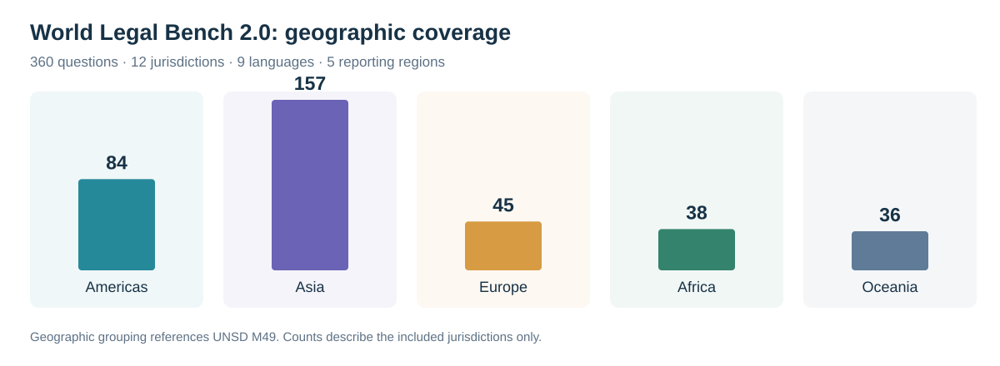

# World Legal Bench 2.0

### Source-linked legal reasoning across twelve jurisdictions and five geographic reporting regions

**World Legal Bench evaluates how language models apply jurisdiction-specific legal rules in the selected language of each legal system.** Its questions test institutional authority, procedural conditions, statutory exceptions, and the legal consequences of changing a material fact.

Version **2.0** contains **360 closed-book multiple-choice questions** across **12 jurisdictions**, **9 languages**, and **5 geographic reporting regions**. Each item retains its original question, four choices, reference answer and official-source references from the parent candidate pool. Every response is graded by an explicitly configured LLM Judge.

[Methodology](docs/methodology.md) · [Evaluation protocol](docs/evaluation.md) · [Dataset card](docs/dataset_card.md) · [Hugging Face card](huggingface/README.md) · [Results and reporting](docs/results.md)

## Geographic coverage and reporting

The reporting groups reference the **United Nations Statistics Division M49 geographic classification**: Americas, Asia, Europe, Africa and Oceania. Jurisdictions remain the legal unit of evaluation; geographic regions provide a compact view of the selected jurisdictions. M49 is a statistical grouping convention, not a claim of political affiliation, United Nations endorsement, or representative coverage of every legal system in a region. [UNSD M49](https://unstats.un.org/unsd/methodology/m49/)

| Reporting region | Included jurisdictions | Items | Share |
|---|---|---:|---:|
| Americas | United States, Canada, Brazil, Mexico | 84 | 23.33% |
| Asia | South Korea, China, Japan, India, Indonesia | 157 | 43.61% |
| Europe | France | 45 | 12.50% |
| Africa | South Africa | 38 | 10.56% |
| Oceania | Australia | 36 | 10.00% |
| **Total** | **12 jurisdictions** | **360** | **100%** |



Item counts are intentionally unequal. The release preserves observed nonpassing cases rather than discarding them to enforce geographic quotas. The [methodology](docs/methodology.md) defines both item-level overall accuracy and an equal-region macro average so that the largest item group does not determine the only headline result.

## A difficulty-selected challenge set

Selection used saved `gpt-6-luna` responses at `max` reasoning effort on the 10,132-item v1.4.2 candidate pool. The release retains **327 scored nonpasses** and adds **33 recorded successes** to supplement legal-topic coverage. Of the nonpasses, **301 were graded incorrect and 26 were graded as invalid final answers**. Execution failures, unscored cases and empty returns did not enter the selection.

The selected historical responses yield **9.17% item-level accuracy** and **9.13% region-macro accuracy**. These are **retrospective selection statistics**, not a fresh model run or an unbiased estimate of legal ability. The same model may answer differently on rerun, and other models may solve the retained cases. The [selection records](provenance/v2.0/selection.jsonl) and [reference profile](provenance/v2.0/reference_selection.json) expose this design choice.

Version 2.0 does not claim independently verified legal correctness or expert certification. This release checks item identity, source binding, recorded grading status, quotas and duplicates; it does not add a new legal expert audit.

## Run and evaluate

Python 3.10 or later is required. Model access is explicit and opt-in.

```bash
python -m pip install -e .
wlb validate
wlb export-prompts --output outputs/prompts.jsonl
```

To collect answers from an OpenAI-compatible Chat Completions endpoint:

```bash
export OPENAI_API_KEY="your-key"
wlb run --base-url https://your-provider.example/v1 --model YOUR_MODEL \
  --output outputs/predictions.jsonl --workers 4 --qpm 60 --max-tokens 131072
```

Grade saved answers, then aggregate the validated Judge decisions:

```bash
wlb judge --base-url https://your-judge-provider.example/v1 --model YOUR_JUDGE \
  --predictions outputs/predictions.jsonl --output outputs/judged.jsonl
wlb score --predictions outputs/judged.jsonl --output outputs/report.json
```

Gold answers are supplied only to the Judge, never to the model being tested. The Judge accepts multilingual choice declarations and unambiguous semantic equivalents. It records a choice, outcome, candidate evidence and explanation. Malformed or inconsistent Judge decisions remain execution errors; they are not silently converted to substantive wrong answers. See the [evaluation protocol](docs/evaluation.md) for reporting requirements.

## Repository layout

| Path | Contents |
|---|---|
| `data/v2.0/` | Current questions, answers, sources, jurisdiction quotas and integrity manifest |
| `provenance/v2.0/` | Selection decisions, parent identity and retrospective reference profile |
| `src/world_legal_bench/` | Prompt export, optional inference/Judge clients and score aggregation |
| `huggingface/` | Self-contained dataset card, viewer data and offline grade aggregator |
| `data/v1.4.1-release/` | Preserved earlier release; not the current evaluation set |

## Interpretation and versioning

Report the exact dataset version, tested model, Judge model, reasoning settings, generation limits and full item coverage. Publish regional and jurisdiction-level breakdowns alongside both overall scores. Geographic groups summarize only the included jurisdictions, and small groups can have substantial score uncertainty.

Version 2.0 changes the selected items, weighting and grading protocol. Its scores are not directly comparable to v1.4.1-release. This is an error-selected challenge set, not a random sample of legal questions, a population-representative measure, or a proxy calibrated to an external general-intelligence ranking.

## License and citation

Code is available under [MIT](LICENSE). Authored questions and documentation use [CC BY 4.0](LICENSE-DATA); underlying legal source materials retain their own terms. See [NOTICE](NOTICE), [CITATION.cff](CITATION.cff) and [CONTRIBUTING.md](CONTRIBUTING.md).
