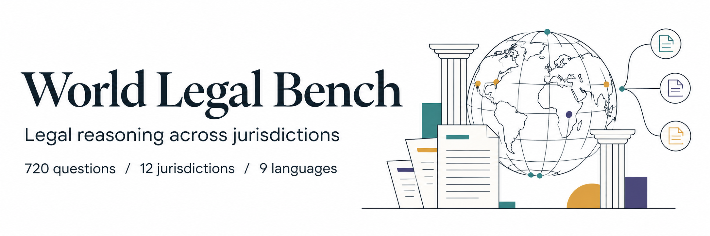
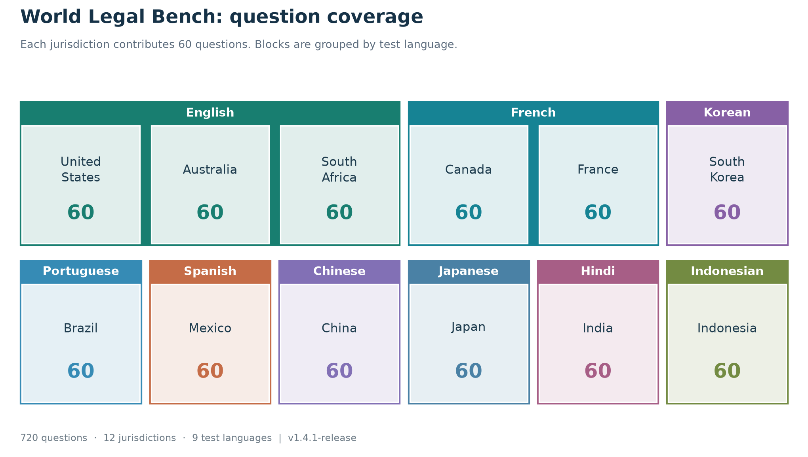
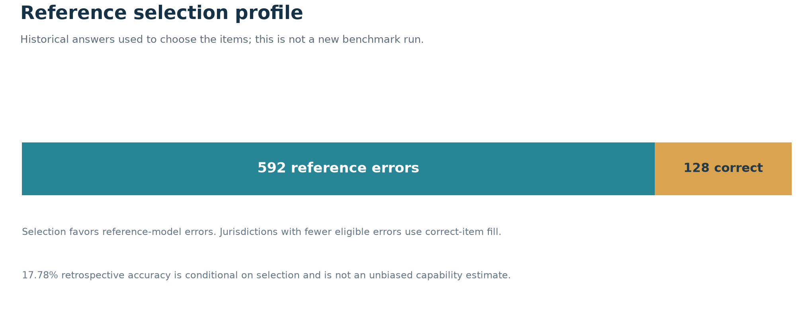
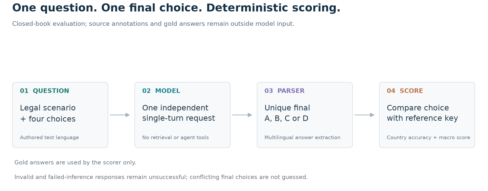

<p align="center"></p>

# World Legal Bench v1.4.1-release

**A source-linked benchmark for evaluating legal reasoning across jurisdictions in their selected test languages.** The release contains **720 multiple-choice questions**, balanced at **60 per jurisdiction**, across **12 jurisdictions and 9 languages**.

Questions test whether a model can apply the stated legal rule to a concrete scenario, distinguish institutional powers, combine provisions, and resolve procedural conditions and exceptions. The scope includes constitutional and public law, administrative procedure, parliamentary rules, judicial remedies, public accountability, and access to information.

- [Methodology and selection profile](docs/methodology.md)
- [Answering and scoring protocol](docs/evaluation.md)
- [Source and selection provenance](provenance/release.json)

## Introduction

Legal competence can vary by jurisdiction even when a model's overall performance is strong. World Legal Bench makes those differences visible through a country-balanced score and a per-jurisdiction breakdown. Its primary aggregate is the unweighted mean of the jurisdiction accuracies; minimum-country accuracy and the highest-to-lowest country gap provide additional views of consistency.

Each item is written for a particular jurisdiction and selected language. This is not a parallel-translation evaluation: countries have different legal rules, topics, and questions. A country score measures their combined demands and does not isolate the effect of language or establish a causal measure of fairness.

The release is a **difficulty-selected evaluation set**. Existing `qwen3.8-flash` responses informed selection, followed by an AI-assisted source and answer quick check of the selected items. Reference-model selection bias is documented below and in the [methodology](docs/methodology.md).

## Dataset description

This repository folder distributes the complete **720-item v1.4.1-release**, with one `test` split and a default configuration. The questions were selected from a 10,132-item parent candidate pool. The parent pool is not included, and this distribution does not define an independently validated private holdout.

Question wording, option order, and reference answers are preserved from the frozen release. The `test` file joins questions and gold answers into a viewer-friendly table. Reference answers are supplied for scoring and must be excluded from model input.

### Coverage

| Jurisdiction | Code | Test language | Test items |
|---|---|---|---:|
| United States | US | English | 60 |
| Canada | CA | French | 60 |
| Australia | AU | English | 60 |
| South Korea | KR | Korean | 60 |
| France | FR | French | 60 |
| Brazil | BR | Portuguese | 60 |
| Mexico | MX | Spanish | 60 |
| China | CN | Simplified Chinese | 60 |
| Japan | JP | Japanese | 60 |
| India | IN | Hindi | 60 |
| South Africa | ZA | English | 60 |
| Indonesia | ID | Indonesian | 60 |
| **Total** | | **9 languages** | **720** |

These are the benchmark's selected test languages, not an exhaustive list of the languages used in each legal system. The row language `zh-Hans` is indexed under the Hub language tag `zh`.



### Columns

| Column | Type | Description |
|---|---|---|
| `country` | string | Jurisdiction code used for scoring, such as `US` or `CN`. |
| `language` | string | Authored test language; Simplified Chinese uses `zh-Hans`. |
| `question_id` | string | Stable item identifier, preserved across export. |
| `question` | string | Scenario and question, including any stated legal version and assumptions. |
| `choices` | list of strings | Four labeled options in fixed A, B, C, D order. |
| `answer` | string | Single gold label: A, B, C, or D. |
| `answer_text` | string | Text of the gold choice, without the label prefix. |
| `task_family` | string | Authored reasoning or procedural category. |
| `source_urls` | list of strings | Official source links associated with the item. |

Full option-level rationales are in [annotations/answers.jsonl](annotations/answers.jsonl). Source locators, edition labels, and available content digests are in [annotations/sources.jsonl](annotations/sources.jsonl). Bulk official legal texts are not redistributed.

## Construction and review

Selection used existing reference responses and did not require new tested-model calls. Empty returns, execution errors, and final choices that remained unresolved were excluded from the correct/error pools. The target was 55 reference mistakes and 5 reference successes per jurisdiction. Where fewer eligible mistakes remained, correct items filled the remaining slots.

Selected items and replacements received an AI-assisted quick check of the legal source, answer alignment, conspicuous ambiguity, missing assumptions, and duplicate options. Ten initially selected items were excluded and replaced. [Item-level records](provenance/reviews.jsonl) preserve the specific review notes in Chinese.

This is an AI-assisted source quick check, not independent legal-expert certification. Some source-version labels refer to authoring snapshots rather than publisher-issued editions. Official URLs can later serve different legal revisions, and the exact original source bytes cannot always be recovered from this distribution alone.

### Reference selection profile

The selected historical responses contain **128 correct and 592 incorrect answers**, a **17.78% retrospective accuracy**. The [per-jurisdiction profile](provenance/reference_selection.json) is included for transparency.



These responses influenced which questions entered the benchmark. The figure is therefore conditional on selection, not an independently reproduced benchmark run or an unbiased estimate of general legal ability. The original provider-response transcripts are not distributed. Rerunning the same model can produce different results.

## Loading the dataset

From this folder, load the explicitly configured local dataset:

```python
from datasets import load_dataset

dataset = load_dataset("./", name="default", split="test")
print(len(dataset))  # 720
print(dataset[0]["question_id"])
```

The JSONL file can also be loaded directly, without interpreting card metadata:

```python
from datasets import load_dataset

dataset = load_dataset(
    "json",
    data_files={"test": "data/test.jsonl"},
    split="test",
)
```

Use the question and its choices as model input. Do not pass the row's `answer`, `answer_text`, annotations, or source materials to a closed-book evaluation. The published Hub repository ID can replace the local directory path once a repository is actually published.

## Answering and scoring approach

The default protocol is closed book, single turn, one independent question per request. It does not provide retrieval, browsing, agent tools, or a conversation history. The system instruction is:

```text
Choose the single best answer to the legal question. Use the legal version and assumptions stated in the question. Return only one uppercase letter: A, B, C, or D.
```

The user message is the unmodified question, followed by the four options on separate lines. The system instruction is English; the question and options retain their authored language. Different instructions or tool access are protocol variations that should be disclosed.



The grader is deterministic. It extracts a unique final choice using `world-legal-final-choice-v1.3`, then compares that choice with the gold label. It recognizes explicit multilingual answer declarations and common Markdown formatting. If a closing `</think>` marker is present, only the segment after its last occurrence is considered. Multiple or conflicting declared answers remain invalid; arbitrary letters in an explanation are not a fallback answer.

For a complete run:

```text
Country accuracy (%) = 100 × correct predictions / 60
Overall score (%)    = mean of the 12 country accuracies
```

Because country counts are equal, the overall score also equals pooled accuracy. Empty, invalid, and failed-inference records count as unsuccessful and are reported separately. Missing records prevent a complete-run score. There is no partial-credit or abstention reward in this multiple-choice protocol.

### Local evaluator

Save one record per item; the evaluator uses `id` to match the dataset's `question_id`:

```json
{"id":"WLB14-US-J0003-001","prediction":"D"}
```

Then run the bundled standard-library evaluator:

```bash
python evaluate.py --predictions predictions.jsonl --output report.json
```

It verifies the bundled file digests and reports overall accuracy, country accuracy, invalid responses, coverage, minimum-country accuracy, and country gap. Duplicate or unknown IDs are rejected. `--allow-partial` is for debugging only and withholds full country-macro metrics. [Protocol details](docs/evaluation.md) describe the output fields.

## Limitations and intended use

The benchmark supports controlled model comparisons and jurisdiction-level error analysis. It does not certify professional legal competence or provide legal advice. Its difficulty profile depends on one reference model's errors, and related questions can share legal provisions.

Country, language, and item content vary together. The country breakdown should not be treated as a causal estimate of language inequality. Each country has a small fixed set of questions, so small differences require cautious interpretation.

Legal questions are evaluated under their stated version and assumptions. A later legal amendment should be handled through a new revision rather than silently changing this frozen answer key. The dataset does not claim that every answer describes the law currently in force on the evaluation date.

The release does not claim to reproduce an external general-intelligence ranking. A public/private correlation analysis, version-to-version model comparison, or multi-model leaderboard requires additional independently collected results and is not provided here.

## Access and citation

This folder is a local preparation of the dataset repository. No live Hub page, paper, DOI, or public leaderboard is asserted. Machine-readable citation metadata is available in [CITATION.cff](CITATION.cff).

```bibtex
@misc{worldlegalbench2026,
  title  = {World Legal Bench: Native-Language Legal Reasoning Across Twelve Jurisdictions},
  author = {{World Legal Bench contributors}},
  year   = {2026},
  note   = {Dataset version 1.4.1-release}
}
```

For an item correction, provide the question ID, the disputed answer or assumption, and an official legal source with a provision locator. See [contributing](CONTRIBUTING.md).

## License

Original authored dataset material and documentation are provided under [CC BY 4.0](LICENSE-DATA). The evaluator code is provided under [MIT](LICENSE). Referenced laws, judgments, quotations, and third-party materials retain their own rights status; see [NOTICE](NOTICE).
